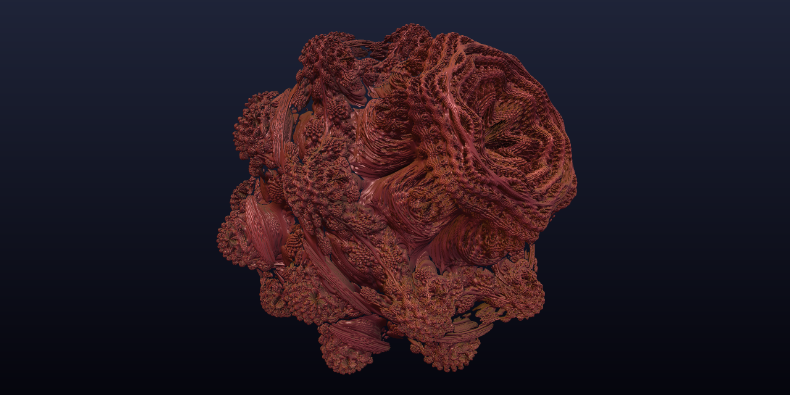

# WebGPU Compute Exploration

[](https://github.com/scttfrdmn/webgpu-compute-exploration/actions/workflows/ci.yml)

**Live demo:** https://scttfrdmn.github.io/webgpu-compute-exploration/

Twenty-five interactive **WebGPU compute shader** examples that run in the browser, written in plain JavaScript and **WGSL** with no build step. They range from basic GPGPU (vector addition, matrix multiplication, Gaussian blur) to real-time simulations (SPH fluid, molecular dynamics, boids flocking, Game of Life, 3D diffusion-limited aggregation, Gray-Scott reaction-diffusion, water waves, falling sand), ray-marched 3D fractals, procedural Perlin/simplex noise, and parallel algorithms and signal processing (GPU FFT audio visualizer, bitonic and radix sort, k-means clustering, Voronoi jump flooding, maze solving), and advanced examples: cloth simulation, a Monte Carlo path tracer, an MNIST CNN that is trained and run entirely in compute shaders, Barnes-Hut N-body gravity with a GPU-built tree, and real-time partitioned-FFT convolution reverb. A Rust/WebAssembly example shows WASM coordinating GPU work.



Open the page in a WebGPU browser and scroll: each interactive example is set up when it comes into view and starts when you press **Start**, so only what you are looking at uses the GPU. Ray marching renders while it is on screen.

## Features

### 1. Vector Addition
Demonstrates basic GPU compute with parallel vector addition on 1 million elements.
- **Shader**: WGSL compute shader with workgroup size optimization
- **Use Case**: Foundation for understanding GPU parallelism
- **Performance**: Processes millions of elements per millisecond

### 2. Matrix Multiplication
Implements efficient matrix multiplication using 2D workgroups.
- **Dimensions**: 512×512 matrices
- **Shader**: Optimized compute shader with proper indexing
- **Use Case**: Neural networks, 3D graphics, scientific computing
- **Performance**: GFLOPS measurements included

### 3. Image Processing (Gaussian Blur)
Real-time image filtering using compute shaders.
- **Algorithm**: Gaussian blur, σ = 4 over a 25×25 kernel
- **Shader**: 2D convolution with boundary handling
- **Use Case**: Video filters, anti-aliasing, depth of field
- **Visualization**: Side-by-side original and blurred images of a sharp-edged test pattern

### 4. Conway's Game of Life
Interactive cellular automaton with GPU acceleration.
- **Grid Size**: 200×150 cells (30,000 cells)
- **Interaction**: Click to toggle cells, load classic patterns
- **Patterns**: Glider, Pulsar, Gosper Glider Gun, R-Pentomino, and more
- **Performance**: Each generation is one compute dispatch; the grid is read back only when you click a cell
- **Features**: Play/pause, step-through, adjustable speed

### 5. Molecular Dynamics Simulation
Real-time 3D physics simulation of interacting particles.
- **Particles**: 100-5000 atoms with Lennard-Jones potential
- **Physics**: Symplectic Euler integration, periodic boundaries, simple velocity-rescaling thermostat
- **Rendering**: Instanced icosahedron atoms with diffuse lighting, inside a glass simulation box with glowing edges
- **Interaction**: Mouse drag to rotate, wheel to zoom, right-drag to pan
- **Visualization**: Speed-based coloring (blue = slow, red = fast)
- **Performance**: O(N²) all-pairs forces on the GPU

### 6. SPH Fluid Simulation
Smoothed Particle Hydrodynamics for realistic fluid dynamics.
- **Particles**: 2,000 particles in a dam-break start; **Add Water** drops in more (up to 4,000)
- **Physics**: 2D Müller et al. kernels (Poly6 density, Spiky pressure, viscosity Laplacian), gravity
- **Algorithm**: 3 compute passes (density, forces, integration), 6 substeps per frame for stability
- **Features**: Adjustable gravity and viscosity
- **Visualization**: Velocity-based coloring with alpha blending
- **Performance**: O(N²) all-pairs neighbor search

### 7. Ray Marching: 3D Fractals
Volumetric rendering of complex 3D fractals using distance fields.
- **Fractals**: Mandelbulb, Julia Set, Menger Sponge, Mandelbox
- **Technique**: Sphere tracing with distance estimators
- **Quality**: Adjustable steps (32-256) for performance/quality trade-off
- **Rendering**: Phong lighting, ambient occlusion, fog
- **Interaction**: Drag to rotate, wheel to zoom, auto-rotation
- **Performance**: Real-time fragment-shader ray marching; renders only while visible

### 8. Boids Flocking Simulation
Craig Reynolds' emergent flocking behavior with thousands of agents.
- **Agents**: 100-10,000 boids with adjustable speed
- **Behaviors**: Separation, alignment, cohesion + special modes
- **Modes**: Normal flocking, predator/prey, scatter, vortex
- **Interaction**: Hold left mouse to attract, right mouse to repel
- **Visualization**: Triangle agents colored by speed
- **Performance**: O(N²) all-pairs neighbor checks on the GPU

### 9. Diffusion Limited Aggregation (3D)
Fractal growth simulation creating dendritic crystal structures.
- **Grid**: 64³ voxel space (262,144 cells)
- **Particles**: 5,000 random walkers, each with its own PCG random state
- **Algorithm**: A walker sticks (with adjustable probability) when next to the aggregate, then retires
- **Seeds**: Single center, line, circle, or multiple points
- **Rendering**: Instanced cubes with gradient coloring
- **Interaction**: Drag to rotate, wheel to zoom, adjustable stickiness

### 10. Reaction-Diffusion (Gray-Scott)
Two virtual chemicals diffuse and react, producing Turing patterns like coral, spots and mazes.
- **Grid**: 512×384 cells that wrap at the edges, (U, V) per cell in two ping-pong storage buffers
- **Algorithm**: Gray-Scott model, 3×3 Laplacian, Du = 1.0, Dv = 0.5, dt = 1.0; 1-32 substeps per frame, one dispatch each
- **Presets**: Coral, Mitosis, Maze, Holes, Chaos, Cells, plus feed and kill sliders
- **Interaction**: Hold the left mouse button and drag to paint chemical V, also while paused
- **Visualization**: Full-screen fragment shader maps V through an Ocean, Magma or Mono color ramp
- **Performance**: Measured FPS and simulation steps per second; no CPU readback

### 11. Wave Equation
Water ripples from the 2D wave equation: drop ripples, draw walls, and watch them reflect and interfere.
- **Grid**: 512×384 cells, one height per cell in two storage buffers (u(t) and u(t−1)) plus a per-cell wall mask
- **Algorithm**: Damped wave equation u_tt + γu_t = c²∇²u, centered (leapfrog) differences and a 5-point Laplacian; Courant number C = 0.1-0.7 (stable up to 1/√2), default 0.5; 1-16 steps per frame, one dispatch each
- **Boundaries**: Walls and the grid edge are fixed at u = 0 and reflect waves; optional absorbing sponge layer at the edges
- **Presets**: Open water, Double slit (plane-wave source, interference fringes), Ellipse (a drop at one focus refocuses at the other)
- **Interaction**: Click or hold to drop ripples, shift-drag to draw walls, Rain toggle with drops placed by a GPU hash
- **Rendering**: Full-screen fragment shader computes surface normals from height differences, diffuse + specular lighting over a blue/teal height ramp
- **Performance**: Measured FPS and simulation steps per second; no CPU readback

### 12. Falling Sand
A sandbox cellular automaton with interacting materials.
- **Grid**: 320×240 cells, one u32 each (material, color shade, fire life or liquid flow direction), updated in place in one storage buffer
- **Algorithm**: Margolus neighborhood: each step one invocation owns a 2×2 block (offset alternating between (0,0) and (1,1)), applies reactions, then moves cells only by swapping; randomness from a PCG hash of block and step
- **Materials**: Sand, water, stone, oil, fire, plant, acid; density order fire < air < oil < water < acid < sand; fire burns oil and plants where there is air, water puts it out, acid dissolves stone, sand and plants, plants grow into water
- **Interaction**: Left mouse paints the selected material, right mouse erases (also while paused); brush size and 1-8 steps per frame; Sandbox scene and Clear
- **Visualization**: Full-screen fragment shader with per-grain shading, flickering fire and a fire glow
- **Performance**: Measured FPS and simulation steps per second; no CPU readback

### 13. Procedural Noise
3D gradient (Perlin) and simplex noise, summed as fractal Brownian motion, for terrain and texture generation.
- **Compute**: One dispatch evaluates the noise for every pixel of a 1024×768 field into a storage buffer (one f32 per pixel)
- **Algorithms**: Improved Perlin noise (quintic fade, 12 edge gradients) and simplex noise, with a PCG integer hash instead of a permutation table; time is the third coordinate
- **fBm**: 1-8 octaves, lacunarity, persistence, optional ridged mode, and domain warping (fBm of fBm)
- **Presets**: Terrain, Mountains, Clouds, Marble, Warped
- **Interaction**: Drag to pan, wheel to zoom; Animate moves through time, and while paused any change re-runs one compute + render
- **Visualization**: Full-screen fragment shader colors the field as hillshaded terrain bands, clouds, veined marble or grayscale
- **Performance**: Measured FPS and noise evaluations per frame; no CPU readback

### 14. FFT Audio Visualizer
A real-time spectrum analyzer with the FFT computed on the GPU instead of by the browser's AnalyserNode.
- **Input**: Web Audio API time-domain samples from a built-in synth demo (chord, exponential sweep, 120 BPM kick; no permissions), the microphone, or a looping audio file
- **Algorithm**: Hann window and bit-reversal permutation in one dispatch, then log2(N) radix-2 Cooley-Tukey butterfly stages, one dispatch each, ping-ponging two complex vec2<f32> buffers; stage index via a dynamic uniform offset; precomputed twiddle table; N = 1024, 2048 or 4096
- **Analysis**: Magnitudes in dBFS with adjustable smoothing, resampled onto 256 log-spaced rows (20 Hz-20 kHz); spectrogram history in a 512-column GPU ring buffer; beat detection (40-150 Hz energy rising above 1.6× its running average) on the GPU
- **Views**: Bars (64 log-frequency bands colored from bass to treble), triggered Waveform, scrolling Spectrogram with a heat color map; a beat flash indicator
- **Controls**: Source buttons, Start/Pause (also suspends the audio), Mute, view, FFT size, smoothing and dB range, presets
- **Performance**: Measured FPS and dispatches per frame; only N samples are uploaded per frame, no CPU readback

### 15. Parallel Sorting
GPU sorting algorithms with a correctness-checked benchmark and an animated bar chart.
- **Algorithms**: Bitonic sort as one global compare-exchange dispatch per (k, j) stage, or with workgroup memory for the stages with j ≤ 256; LSD radix sort with 4-bit digits (8 passes of per-workgroup histogram, single-workgroup exclusive scan, stable scatter)
- **Benchmark**: 65,536 to 4,194,304 u32 or f32 keys (f32 via the order-preserving bit flip); non-power-of-two sizes are padded with 0xFFFFFFFF for bitonic; the result is read back once and compared element by element with the CPU sort of the same input
- **Performance**: GPU time (best of 3, submit to `onSubmittedWorkDone`) next to `Uint32Array`/`Float32Array.prototype.sort`, keys per second and dispatch count
- **Visualization**: 512-2048 bars sorted by bitonic sort one stage per tick (Play, Pause, Step, Shuffle, 1-60 stages per second) with Random, Reversed, Nearly sorted and Few unique data; the background and a strip under the bars show the next stage's block size k and compare distance j
- **Rendering**: Full-screen fragment shader reads the sorted storage buffer directly; no CPU readback during the animation

### 16. K-Means Clustering
Lloyd's algorithm on a 2D point cloud, one iteration at a time so you can watch it converge.
- **Data**: 10k-500k points from 1-16 anisotropic Gaussian blobs plus 0-50% uniform noise, generated on the CPU from a seed
- **Assignment**: One invocation per 4 points finds the nearest of K = 2-16 centroids and counts label changes with an atomic counter
- **Update**: Two-level reduction: each workgroup tree-reduces per-cluster (sum x, sum y, count, squared distance) for its 1,024 points in workgroup memory, then one workgroup sums the partials; empty clusters keep their old centroid
- **Initialization**: Random data points or k-means++ (on the CPU, from up to 20,000 sampled points)
- **Convergence**: Stops when no point changes cluster; iteration, changed points, inertia and cluster sizes in the info panel from an 80-byte readback per iteration
- **Rendering**: Instanced point quads colored by cluster, centroid markers with trails of their last 23 moves, optional Voronoi overlay (full-screen fragment shader, nearest centroid per pixel, with cell borders)
- **Controls**: Start/Pause, Step, Reset, Regenerate, K, point count, true cluster count, noise, iterations per second, init method, Voronoi toggle; FPS readout

### 17. Voronoi (Jump Flooding)
Voronoi diagrams and distance fields for up to 1024 seeds with the Jump Flooding Algorithm (Rong & Tan 2006).
- **Grid**: 1024×768 pixels, one u32 seed index each in two ping-pong storage buffers; seeds (position + color) in a storage buffer
- **Algorithm**: A seed pass writes each seed's index into its pixel (atomicMin), then 10 flood passes with steps 512, 256, …, 1; each pixel checks itself and its 8 neighbors at ±step and keeps the closest seed. Optional JFA+1 adds a final step-1 pass. One dispatch per pass, each with its own dynamic-offset uniform slot
- **Metrics**: Euclidean, Manhattan, Chebyshev
- **Interaction**: Click to add a seed, drag to move one, right-click or shift-click to remove the nearest; Random seeds (2-1024), Clear, and Random / Jittered grid / Sunflower / Clusters layouts; Animate lets the seeds drift and bounce, and while paused every edit recomputes once
- **Visualization**: Colored cells with dark borders, a grayscale distance field with iso-distance lines, or both combined; seeds drawn as dots
- **Accuracy**: Exact check brute-forces the nearest seed for every pixel on the GPU and reads back the number of pixels where JFA is wrong
- **Performance**: Measured FPS, dispatches and pixel updates per frame; no CPU readback except the exact check

### 18. Maze Generation & Solving
Which graph algorithms parallelize: mazes are carved on the CPU and solved by a breadth-first wavefront on the GPU.
- **Mazes**: 63×47, 255×191, 511×383 or 1023×767 cells, one u32 per cell with open-passage bits, drawn as the (2w+1)×(2h+1) wall lattice
- **Generation (CPU)**: Recursive backtracker (DFS), Kruskal's (shuffled walls + union-find) and randomized Prim's, all sequential by nature; a Loops slider removes 0-30% of the remaining walls so several routes exist
- **Solving (GPU)**: One compute dispatch per BFS level, one invocation per cell: an unreached cell next to a cell at distance d takes d+1. Writes only touch the invocation's own cell, so the result is order-independent and equals a queue-based BFS; 1-512 levels per frame through dynamic uniform offsets
- **Termination**: A 12-byte readback (cells reached, largest distance, goal distance) every 4 frames; then one distance-field readback and a CPU walk from the goal to a neighbor one step closer gives a shortest path
- **Interaction**: Click to set the start, shift-click or right-click to set the goal; Solve, Pause, Clear solution, steps per frame
- **Visualization**: Flood colored by distance with the wavefront highlighted, shortest path in yellow
- **Performance**: Measured FPS, generation time, BFS levels, cells visited, path length

### 19. Cloth Simulation
A hanging, draping and tearing fabric simulated with position-based dynamics (PBD).
- **Cloth**: 32×32 to 128×128 particles (xyz + inverse mass, previous position for Verlet) joined by structural, shear and bend distance constraints, up to 97,026 links
- **Solver**: Fixed 1/240 s substeps: Verlet integration (gravity, gusty wind and air drag along the per-vertex normals), long-range tethers to the nearest pins, 1-30 Gauss-Seidel iterations, then collisions. The links are split by graph coloring into 12 sets in which no two links share a particle, one dispatch per color, so the parallel projections never race; each dispatch picks its range through a dynamic uniform offset
- **Collisions**: Sphere and floor with Coulomb friction (static and kinetic), so a draped cloth stays put
- **Tearing**: Optional; a structural or shear link stretched past the threshold (1.1-4×) is flagged as broken and skipped, bend links break with the links they span, and the mesh omits triangles with a broken edge
- **Presets**: Hang from two corners, Hang from top edge, Curtain (gathered on a rod, wind, a sphere behind it), Drop on sphere, Flag (strong gusty wind)
- **Interaction**: Orbit, pan and zoom camera; shift-drag grabs the cloth at the particle nearest the mouse ray (one position readback per grab, picked on the CPU) and pulls a small patch around it
- **Rendering**: Lit two-sided mesh (gingham front, blue back) with normals computed on the GPU, optional wireframe and particles, a sphere and a grid floor, 4× MSAA
- **Controls**: Start/Pause/Reset, presets, grid size, iterations, stiffness, wind, gravity, tearing toggle and threshold; info panel with particle and link counts, torn links and FPS

### 20. Path Tracer
Monte Carlo path tracing with progressive accumulation: one path per pixel per frame, averaged until a target sample count.
- **Scenes**: Cornell box (rotated box, glass and metal spheres), Spheres (checker ground, 61 spheres of mixed materials, sky light), Caustics (glass sphere focusing a small light), Materials (diffuse, mirror, rough gold and two glass spheres on rotated pedestals under an area light and a sphere light)
- **Geometry**: Spheres, parallelogram quads, boxes rotated about the vertical axis and infinite planes, packed as 96-byte vec4 records in a storage buffer; brute-force closest hit over at most 64 primitives
- **Materials**: Lambertian diffuse (cosine-weighted sampling), metal with roughness, glass (Schlick Fresnel, Snell refraction, total internal reflection), emissive
- **Light transport**: Next-event estimation (area sampling for quad lights, cone sampling for sphere lights) combined with BSDF sampling by multiple importance sampling (power heuristic); 1-8 bounces, Russian roulette after the third; PCG random numbers seeded from pixel and sample index
- **Camera**: Orbit, pan and zoom, field of view, thin-lens depth of field with click-to-focus (one CPU ray against the same scene data)
- **Display**: Running average in a vec4 storage buffer, exposure, ACES or Reinhard tone mapping, sRGB; optional firefly clamp; 100%, 75% or 50% of 800×600
- **Performance**: Samples per pixel, FPS and rays per second from a GPU ray counter (4-byte readback twice a second); stops at 64-4096 spp so the GPU idles once converged

### 21. MNIST: Train
A small CNN learns handwritten digits in the browser, with every step of training in compute shaders.
- **Network**: 28×28 input → conv 5×5×8 → ReLU → 2×2 max-pool → conv 5×5×16 → ReLU → 2×2 max-pool → dense 256→10 → softmax; 5,994 weights, shared with example 22 through `js/examples/mnist-model.js`
- **Data**: the first 10,000 MNIST training and 2,000 test images (gzipped, 1.9 MB, loaded on the first Start); shuffled on the CPU every epoch, batches gathered on the GPU by index, each image shifted by a hashed random offset of up to ±2 px
- **Training (GPU)**: forward pass, log-sum-exp softmax cross-entropy, backprop through the dense layer, both max-pools (gradient to the window's argmax), both ReLUs and both convolutions; per-sample gradients in their own buffer rows, then one invocation per weight sums its batch in order (race-free, no atomics) and applies SGD with momentum, weight decay and a per-epoch learning-rate decay. 14 dispatches per mini-batch, 1-16 mini-batches per frame
- **Charts**: training loss (log scale) and accuracy curves with hover readout, test accuracy after every epoch, epoch/batch counters and images per second, from a 32-byte readback per frame
- **Filters**: the 8 first-layer 5×5 kernels drawn from the GPU weights buffer every frame
- **Controls**: Start/Pause, Reset (next seed), learning rate, batch size (32/64/128), epochs, batches per frame, random shifts; Export weights (.bin) and Use in Recognize
- **Same algorithm as the cached weights**: `tools/train-mnist.mjs` trains the same network on the CPU (98.00% test accuracy with the default settings); a browser run with the defaults and first seed repeats it
- **Data license**: MNIST by LeCun, Cortes and Burges, CC BY-SA 3.0 (see `data/mnist/LICENSE.md`)

### 22. MNIST: Recognize
Draw a digit and classify it on the GPU with the same network.
- **Weights**: `data/mnist/weights.bin` (trained by `tools/train-mnist.mjs`, 98.00% on the 2,000 test images) by default, or the weights handed over by example 21; the status shows which
- **Drawing**: 280×280 canvas, mouse, pen or touch (pointer events), Clear
- **Preprocessing (CPU)**: like MNIST: bounding box scaled to fit 20×20 with area averaging, then shifted so the center of mass sits at the middle of 28×28
- **Inference (GPU)**: batch-1 forward pass when a stroke ends and every 120 ms while drawing; a 40-byte readback of the probabilities
- **Visualization**: 10 confidence bars, the 28×28 input the network sees, and the ReLU activation maps of both conv layers (8 × 24×24, 16 × 8×8), drawn from the GPU buffer
- **Random test digit**: one of the 2,000 test images with its true label and whether the prediction is right
- **Data license**: the cached weights are derived from MNIST and are CC BY-SA 3.0, like the data

### 23. N-Body Gravity (Barnes-Hut)
Self-gravitating stars with two force solvers, leapfrog integration and an energy-conservation readout.
- **Bodies**: 4,096 to 262,144 equal-mass bodies (xyz + mass, velocity + origin tag), Plummer-softened gravity with G = 1
- **Brute force**: O(N²) direct sum with 256-body tiles in workgroup memory (GPU Gems 3, ch. 31), up to 32,768 bodies
- **Barnes-Hut (GPU-built tree every step)**: bounding-box reduction, 30-bit Morton codes, 8-pass radix sort of (code, index), binary radix tree per Karras 2012 (duplicate codes made unique by index), bottom-up mass, center of mass and bounds with an atomic visit counter per node, then a per-body traversal with a 64-entry stack and the opening test d < l/θ + δ; 33 dispatches per step
- **Integration**: kick-drift-kick leapfrog with a fixed time step, 1-4 steps per frame (fewer when a frame would exceed 2·10⁹ interactions)
- **Presets**: Spiral galaxy (exponential disk + Plummer bulge, circular velocities from the enclosed mass), Galaxy collision (two disks on a parabolic encounter), Plummer sphere (virialized), Cold collapse (uniform sphere at rest)
- **Rendering**: additive point sprites with a soft glow in an HDR target, exponential tone mapping; colored by speed or by origin; optional fading trails from a ring buffer of 8 past positions per body
- **Readout**: N, mode, interactions per frame (measured on the GPU for Barnes-Hut), FPS, and the energy drift (E − E₀)/|E₀| from a GPU reduction of the kinetic and potential energy with a 16-byte readback once per second
- **Controls**: Start/Pause/Reset, presets, body count, mode, θ (0.3-1), softening, time step, speed, color mode, trails; orbit, pan and zoom camera

### 24. Convolution Reverb
A live stereo signal convolved on the GPU with an impulse response of up to 6 s, with an A/B switch to the browser's ConvolverNode.
- **Impulse responses**: generated procedurally, no files: Small room, Concert hall, Cathedral, Plate and Reverse. Decorrelated stereo noise split into three bands, each with its own exponential decay (highs die first), plus a build-up, early reflections and a pre-delay; Decay (RT60) and Pre-delay sliders. Or upload a WAV (first two channels, up to 6 s). The RT60 is measured from the Schroeder integral (T30)
- **Algorithm**: uniformly partitioned overlap-save (Gardner 1995, Wefers 2015). The IR is cut into P partitions of B = 1024 or 2048 samples, each FFT'd once at N = 2B (batched dispatches). For every input block the GPU runs an FFT of [previous, current] block into a frequency-domain delay line, sums X·H over all P partitions in one dispatch (one invocation per bin, loop bounded at 563), runs one inverse FFT and keeps the last B samples. Radix-2 FFT stages are separate dispatches with dynamic uniform offsets
- **Stereo**: both channels share one complex FFT (z = L + i·R). The spectra are split with Z[k] and conj(Z[N−k]), and Y = Y_L + i·Y_R comes back from a single inverse FFT
- **Streaming**: an inline AudioWorklet posts each block to the main thread, which convolves it on the GPU and posts the wet block back (one 8-16 KB readback per block). Wet block k plays at a fixed delay of (1 + D)·B samples: one block for the partition plus D = 1-5 blocks of GPU slack (64 ms at B = 1024, D = 2, 48 kHz). A late block plays as silence and is counted as an underrun. The dry path and the ConvolverNode are delayed to match
- **Accuracy**: a self-test per IR pushes a noise block through every partition and compares six read-back blocks with a direct CPU convolution; the first non-silent block of each stream is checked the same way. Both are shown in the info panel
- **Sources**: built-in synth demo (plucks, claps, a chord, with gaps for the tails; no permissions), microphone (on button press), looping audio file
- **Controls**: Start/Stop, sources, Bypass, A/B (GPU vs ConvolverNode), Space presets, decay, pre-delay, wet/dry mix, output gain (at most 0.5, then a limiter and a soft clip), block size, GPU slack
- **Visualization**: render pass showing the IR waveform, its spectrogram with the energy decay curve and the RT60 marker, the latest input and wet blocks, and peak meters for input, wet and output
- **Performance**: round-trip time per block against its deadline, backlog, underruns, and the self-test throughput in multiples of realtime

### 25. WASM Integration (Mandelbrot Set)
Demonstrates Rust/WASM coordinating WebGPU compute shaders.
- **Architecture**: Rust handles configuration, WebGPU performs computation
- **Rendering**: 800×600 fractal with HSV color mapping
- **Use Case**: Complex applications requiring both CPU and GPU
- **Performance**: Full pipeline benchmarking

## Browser Support

WebGPU ships by default in (as of late 2026):
- **Chrome / Edge 113+** on Windows, macOS and ChromeOS; Android 121+. On Linux it is behind `chrome://flags/#enable-unsafe-webgpu` for most hardware.
- **Firefox 141+** on Windows and **147+** on Apple silicon Macs. Linux, Android and Intel Macs are Nightly-only.
- **Safari 26+** on macOS, iOS, iPadOS and visionOS.

Check support at: https://caniuse.com/webgpu

### Sharing a device report

To help track which examples work where, press **Copy device report** at the top of the page after trying
some examples. It copies a Markdown report to your clipboard: browser and user agent, the GPU adapter's
info, features and limits (next to the default device limits the page uses), the preferred canvas format and
WGSL language features, the last FPS and a few counters from each interactive example you opened, the first
lines of any one-shot results, and WebGPU errors or device loss seen this session. You can preview the exact
text first. Nothing is sent anywhere; paste it into a
[device report issue](https://github.com/scttfrdmn/webgpu-compute-exploration/issues/new?template=device-report.md)
if you want to share it.

## Setup

### Quick Start (JavaScript Only)

```bash
python3 -m http.server 8000
```

Then open http://localhost:8000 in a WebGPU-compatible browser.

### Full Setup (with WASM)

1. **Install Rust** via rustup (if not already installed):
```bash
curl --proto '=https' --tlsv1.2 -sSf https://sh.rustup.rs | sh
```

2. **Install wasm-pack**:
```bash
cargo install wasm-pack
```

3. **Build WASM module**:
```bash
./wasm/build.sh   # or: npm run build-wasm
```

   `build.sh` needs a `rustc` with the `wasm32-unknown-unknown` target. With rustup: `rustup target add wasm32-unknown-unknown`. If a Homebrew `rustc` shadows rustup's, put `~/.cargo/bin` first on `PATH`.

4. **Start development server**:
```bash
python3 -m http.server 8000
```

5. Open http://localhost:8000

### Validation

The shaders are checked in three layers, all in CI on every push and pull request:

1. **Static validation** (`wgsl` job): naga parses and validates every WGSL module the examples ship.
2. **CPU reference suite** (`test` job): JavaScript replicas of the shader algorithms and the examples'
   real JavaScript, compared against independent references. Runs anywhere, no GPU.
3. **Real-shader execution on a software GPU** (`gpu-software` job): `test/gpu/` compiles the exact WGSL
   from `wgslModules()`, dispatches it through Dawn's Node bindings (the `webgpu` npm package) on Mesa
   lavapipe, a CPU-only Vulkan driver, and compares the read-back buffers with the CPU references.
   This tests the WGSL itself, which the replicas cannot.

The GPU tests **never run locally by default**: `npm test` only picks up `test/*.test.mjs`, and
`test/gpu/harness.mjs` refuses to start unless `CI=true` on Linux and the adapter reports a software
device (llvmpipe/lavapipe/SwiftShader or a fallback adapter). Driving a real GPU from automated tests
can hang it, so leave `test/gpu/` to CI.

Every example exports `wgslModules()`, the WGSL modules it passes to `createShaderModule`. CI validates
each one offline with [naga](https://github.com/gfx-rs/wgpu/tree/trunk/naga) (no GPU or browser needed).
To run the same check locally:

```bash
cargo install naga-cli --version 30.0.1 --locked
npm run validate:wgsl   # or: NAGA=/path/to/naga node tools/validate-wgsl.mjs
```

`test/` holds a CPU reference test suite, one `*.test.mjs` per example, using only Node's built-in
`node:test` and `node:assert` (Node 22+; no npm install, no GPU, no browser). CI runs it on every push:

```bash
npm test                               # or: node --test 'test/*.test.mjs'
node --test test/fft-audio.test.mjs    # one example
```

Each test prints its measured numbers (accuracy, mismatch rates, energy drift, ...) as diagnostics
and asserts a documented tolerance. There are two kinds of check:

- **Shipped code.** Where an example's logic is JavaScript (maze generators, scene builders, presets,
  impulse responses, the MNIST weight format and CPU trainer, camera and matrix helpers, uniform
  writers), the test imports and runs the real code. Uniform writers run against a mock device that
  records `writeBuffer` bytes; the bytes are decoded with offsets computed from the example's own WGSL
  struct (`test/helpers/wgsl-layout.mjs` implements WGSL's alignment rules), so a `u32` written as an
  `f32` or a misaligned `vec2` fails.
- **CPU replicas.** Where the algorithm lives in WGSL, the test has a JavaScript replica of the
  shader's math and index arithmetic, compared to an independent straightforward reference (naive
  DFT, CPU sort, brute-force nearest seed, direct N-body sum, direct convolution, queue BFS, finite
  differences, ...). A replica validates the algorithm, not the WGSL itself: if the shader and its
  replica drift apart the test cannot tell. Files that use one say so at the top.

Tests marked `todo` record known bugs the suite found. Each one fails until its example is fixed, but a
`todo` failure does not fail the run.

## Project Structure

```
webgpu/
├── .github/
│   ├── workflows/                     # CI and GitHub Pages deployment
│   └── ISSUE_TEMPLATE/device-report.md # Issue template for shared device reports
├── assets/
│   └── social-preview.png             # Preview image (README, link previews)
├── data/
│   └── mnist/                         # MNIST subset + cached weights (CC BY-SA 3.0, see LICENSE.md)
├── index.html                          # Main application page
├── js/
│   ├── main.js                        # Entry point; sets up examples as they scroll into view
│   ├── webgpu-utils.js                # WebGPU helper functions
│   ├── gpu-timer.js                   # GPU pass timing with timestamp queries
│   ├── device-report.js               # Builds the opt-in Markdown device report
│   ├── examples/
│   │   ├── vector-addition.js         # Example 1: Vector addition
│   │   ├── matrix-multiplication.js   # Example 2: Matrix multiply
│   │   ├── image-blur.js              # Example 3: Image processing
│   │   ├── game-of-life.js            # Example 4: Conway's Game of Life
│   │   ├── molecular-dynamics.js      # Example 5: Molecular dynamics
│   │   ├── sph-fluid.js               # Example 6: SPH fluid simulation
│   │   ├── ray-marching.js            # Example 7: Ray marching fractals
│   │   ├── boids.js                   # Example 8: Boids flocking
│   │   ├── dla-3d.js                  # Example 9: 3D DLA
│   │   ├── reaction-diffusion.js      # Example 10: Gray-Scott reaction-diffusion
│   │   ├── wave-equation.js           # Example 11: 2D wave equation (water ripples)
│   │   ├── falling-sand.js            # Example 12: Falling sand (Margolus automaton)
│   │   ├── noise.js                   # Example 13: Perlin/simplex noise and fBm
│   │   ├── fft-audio.js               # Example 14: GPU FFT audio visualizer
│   │   ├── parallel-sort.js           # Example 15: Bitonic and radix sort, sorting visualization
│   │   ├── kmeans.js                  # Example 16: K-means clustering (Lloyd's algorithm)
│   │   ├── voronoi-jfa.js             # Example 17: Voronoi diagrams via jump flooding
│   │   ├── maze.js                    # Example 18: Maze generation and GPU BFS solving
│   │   ├── cloth.js                   # Example 19: Cloth simulation (PBD, graph-colored solver, tearing)
│   │   ├── path-tracer.js             # Example 20: Monte Carlo path tracer
│   │   ├── mnist-model.js             # Shared CNN for 21/22: WGSL kernels, GPU driver, weights format
│   │   ├── mnist-train.js             # Example 21: Train a CNN on MNIST in compute shaders
│   │   ├── mnist-recognize.js         # Example 22: Recognize hand-drawn digits
│   │   ├── nbody.js                   # Example 23: N-body gravity (brute force and GPU-built Barnes-Hut tree)
│   │   ├── convolution-reverb.js      # Example 24: Partitioned FFT convolution reverb (AudioWorklet + GPU)
│   │   └── wasm-mandelbrot.js         # Example 25: WASM integration
│   └── wasm-pkg/                      # Built WASM module (generated)
├── test/                              # CPU reference tests (npm test), one per example
│   ├── gpu/                           # Shipped WGSL executed on a software GPU (CI only, never locally)
│   └── helpers/                       # WGSL struct layout calculator, mock GPU device, shared references
├── tools/
│   ├── train-mnist.mjs                # CPU trainer that writes data/mnist/weights.bin
│   └── validate-wgsl.mjs              # Validates every example's WGSL modules with naga (CI)
├── wasm/
│   ├── Cargo.toml                     # Rust dependencies
│   ├── build.sh                       # WASM build script
│   └── src/
│       └── lib.rs                     # Rust/WASM source code
├── CHANGELOG.md
├── CITATION.cff
├── CLAUDE.md                          # Notes for AI coding assistants
├── LICENSE
├── package.json                       # npm scripts: dev server, WASM build, WGSL validation
└── README.md
```

## Technical Details

### WebGPU Compute Shaders

All examples use WGSL (WebGPU Shading Language), the modern shader language designed specifically for WebGPU:

```wgsl
@compute @workgroup_size(64)
fn main(@builtin(global_invocation_id) global_id: vec3<u32>) {
    // Your compute code here
}
```

### Key Concepts

**Uniform layout**: Uniform structs follow WGSL alignment rules (vec2 on 8 bytes, vec3/vec4 on 16), and `u32` fields must be written through a `Uint32Array` view. Writing an integer as a float turns a count like 2,000 into about 1.1 billion, which can hang the GPU.

**Workgroups**: GPUs process data in parallel workgroups. Each workgroup contains multiple threads (invocations).

**Storage Buffers**: Used for large data that the shader reads/writes.

**Uniform Buffers**: Used for small configuration data that's constant across invocations.

**Pipeline**: Defines how shaders and resources are bound together.

### WASM Integration Pattern

The WASM example demonstrates a powerful pattern:

1. **Rust/WASM**: Manages application state, configuration, and complex CPU logic
2. **WebGPU**: Performs compute-intensive parallel operations
3. **Canvas API**: Renders results via WASM

This architecture is ideal for:
- Game engines (logic in WASM, rendering in WebGPU)
- Scientific computing (algorithms in Rust, computation on GPU)
- ML inference (model management in WASM, matrix ops on GPU)

## Measuring performance

Examples that report performance show two numbers, e.g. `GPU: 1.23 ms · wall: 16.67 ms`:

- **GPU** time comes from the optional `timestamp-query` feature (`js/gpu-timer.js`): the GPU records a
  timestamp at the start and end of each timed pass, so it is pure execution time. Interactive
  examples show a moving average per frame (broken down by pass), one-shot benchmarks the single run.
  The feature is requested only when the adapter offers it; otherwise the readout says
  "GPU time: not available (timestamp-query unsupported)". The page header shows which applies.
- **Wall** time is measured with `performance.now()` on the CPU: end to end for one-shot examples
  (setup, upload, kernel, readback), submit → done for the sort benchmark, and the frame interval
  (1000 / FPS) for animations. It includes JavaScript, driver and queue latency, and vsync.

Chrome quantizes timestamp-query results to ~100 µs to limit timing attacks unless WebGPU developer
features are enabled (`chrome://flags/#enable-webgpu-developer-features`), so very short passes read as
0 or 0.1 ms; long passes and averages over many frames are still meaningful.

## Performance Tips

1. **Buffer Management**: Reuse buffers when possible to avoid allocation overhead
2. **Workgroup Size**: Optimize for your GPU (typically 64, 128, or 256)
3. **Memory Layout**: Use contiguous memory for better cache performance
4. **Async Operations**: WebGPU operations are asynchronous - use promises properly
5. **Data Transfer**: Minimize CPU↔GPU transfers, keep data on GPU when possible

## Learning Resources

- [WebGPU Specification](https://gpuweb.github.io/gpuweb/)
- [WGSL Specification](https://gpuweb.github.io/gpuweb/wgsl/)
- [WebGPU Samples](https://webgpu.github.io/webgpu-samples/)
- [GPU Gems (Advanced Techniques)](https://developer.nvidia.com/gpugems/gpugems/contributors)
- [Shadertoy](https://www.shadertoy.com/) — a large body of shader techniques
- Books: *Real-Time Rendering* (Akenine-Möller et al.), *Physically Based Rendering* (Pharr, Jakob, Humphreys)
- Papers: "Position Based Dynamics" (Müller et al.), "Particle-Based Fluid Simulation for Interactive Applications" (Müller et al.), "Fast Parallel GPU-Sorting Using a Hybrid Algorithm" (Sintorn & Assarsson)

## Extending This Project

Ideas for further examples are tracked as [issues](https://github.com/scttfrdmn/webgpu-compute-exploration/issues?q=is%3Aissue+label%3A%22type%3A+feature%22), grouped into milestones and on the [project board](https://github.com/users/scttfrdmn/projects/85).

## Support

If you find this project helpful, consider supporting my work:

[](https://ko-fi.com/scttfrdmn)

## Troubleshooting

### WebGPU Not Detected
- Ensure you're using a compatible browser version
- Check chrome://gpu/ (Chrome/Edge) or about:support (Firefox)
- Update your graphics drivers

### WASM Module Fails to Load
- Run the build script: `./wasm/build.sh`
- Check that `js/wasm-pkg/` directory exists
- Ensure wasm-pack installed correctly

### Example Shows Nothing or Runs Slowly
- Interactive examples wait for **Start**; scroll to the example and press it
- Lower the particle/agent count or ray-marching quality on weaker GPUs
- Open DevTools: WebGPU validation errors are logged to the console

### Linux
- Chrome and Edge keep WebGPU behind `chrome://flags/#enable-unsafe-webgpu` on most Linux hardware

## License

[MIT](LICENSE) © 2025-2026 Scott Friedman

The MNIST data subset and the weights derived from it in `data/mnist/` are CC BY-SA 3.0 (MNIST by Yann LeCun, Corinna Cortes and Christopher J.C. Burges); see [data/mnist/LICENSE.md](data/mnist/LICENSE.md).

## Contributing

This is an exploration project. If you add new examples or improvements:
1. Keep examples focused and well-documented
2. Include performance metrics; target 60 FPS for interactive simulations (30 FPS minimum for heavy rendering)
3. Offer quality/size controls so the example scales down to weaker and mobile GPUs
4. Provide interactive controls and preset configurations
5. Add shader code comments explaining the algorithm
6. Update this README and CHANGELOG with your additions
