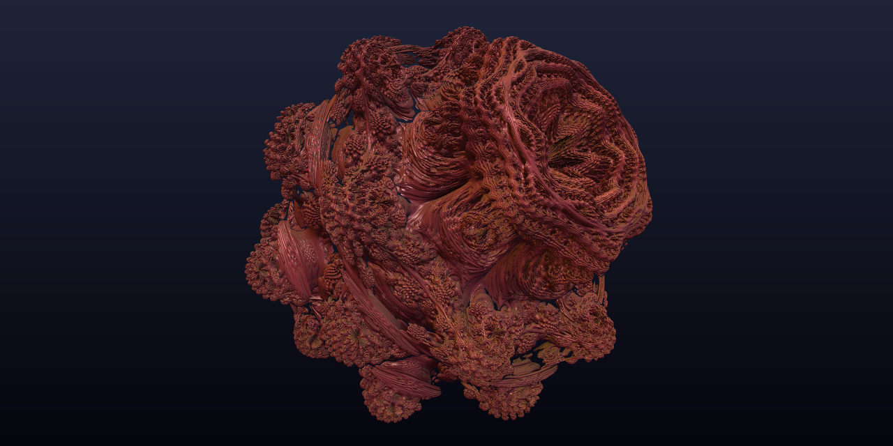

# WebGPU Compute Exploration

[](https://github.com/scttfrdmn/webgpu-compute-exploration/actions/workflows/ci.yml)

**Live demo:** https://scttfrdmn.github.io/webgpu-compute-exploration/

A browser laboratory for **GPU computing and computational science**: twenty-five **WebGPU** compute-shader
examples in plain JavaScript and **WGSL** (no build step), from vector addition to Barnes-Hut gravity, an MNIST
network trained in compute shaders and a Monte Carlo path tracer. Every example has an interactive **Explore** tab,
an **Understand** page and **Measure** experiments that run on your GPU, check their answers against CPU references and
test predictions against your measurements — at three visitor levels, from middle school to college.



## Start here

- **[Reference investigations](https://scttfrdmn.github.io/webgpu-compute-exploration/#reference-investigations)** — matrix multiplication, N-body gravity and parallel
  sorting, each with a question, a fixed measurement protocol, a check against an independent reference and
  predictions you can test on your own GPU.
- **Learning paths** — a five-step first look for [Beginners](https://scttfrdmn.github.io/webgpu-compute-exploration/learn.html?level=beginner), a core-ideas track for
  [Intermediate](https://scttfrdmn.github.io/webgpu-compute-exploration/learn.html?level=intermediate) and two tracks (GPU programming, computational science) at
  [Advanced](https://scttfrdmn.github.io/webgpu-compute-exploration/learn.html).
- **[Validation on physical GPUs](#validation-on-physical-gpus)** — what the reference investigations measured on real
  hardware, per device and browser, and how to [run the validation on yours](https://scttfrdmn.github.io/webgpu-compute-exploration/validate.html).
- **[For teachers and parents](https://scttfrdmn.github.io/webgpu-compute-exploration/facilitate.html)** — session guides with an observation rubric for running an
  investigation with one learner, per level (N-body at Beginner and Intermediate, matrix multiplication at Advanced).
- **[All 25 examples](#the-25-examples)** — the catalog.

## Visitor levels

A **Level** menu at the top of the catalog and the learning path switches between **Beginner** (middle school),
**Intermediate** (high school) and **Advanced** (college and beyond). The science does not change with the level;
the explanation does: fewer controls and "what to look for" prompts in Explore, simpler Understand pages, plain-language
predictions and results in Measure, and a learning path per level. The same experiments run and produce the same
result records at every level. A link with `?level=beginner` opens the site at that level and keeps it; a first-time
visitor is asked once whether to learn or explore the technical details. Lower-level pages are checked for their
outline and reading level (`js/teach/readability.js`), which is a mechanical check, not proof that they work for a
learner.

## Explore, Understand, Measure

Every example has three tabs, aimed at two audiences: people learning **GPU programming** (buffers, workgroups,
synchronization, transfers) and people learning **computational science** (stability, convergence, accuracy,
scaling).

- **Explore** — the interactive demo. Each example is set up when it scrolls into view and runs only after you
  press **Start**, so only what you are looking at uses the GPU; it pauses when it scrolls off screen.
- **Understand** — how the algorithm works, how it maps to the GPU and why it maps well or poorly, its numerical
  behaviour, things to try, and references (Markdown with MathML equations, `content/understand/<id>.md`).
- **Measure** — experiments you start on your own GPU (e.g. Barnes-Hut opening angle vs force error, scaling
  against brute force), checked against CPU references in the browser and charted. Each experiment uses fixed,
  capped problem sizes and repeats each measurement (median and interquartile range, with a phase breakdown where
  it applies). Each step's GPU work is capped and the 20 s budget is checked between steps. Results carry
  PASS/FAIL checks against the references and can be downloaded as a versioned JSON record (schema
  `schema/experiment-result.v1.json`, stamped with the source commit) and compared with someone else's file.

Deep links open a tab directly, e.g. `#nbody/understand` or `#nbody/measure`.

- **Learning path** — [learn.html](https://scttfrdmn.github.io/webgpu-compute-exploration/learn.html) orders the examples into steps.

### Reference investigations

Three examples are worked up to a common standard and featured at the top of the landing page: **matrix
multiplication** (does time grow like n³, and does tiling beat the naive kernel?), **N-body gravity (Barnes-Hut)**
(does the force error grow like θ², and where does the tree overtake the O(N²) direct sum?) and **parallel sorting**
(radix O(N) vs bitonic O(N log² N), and a crossover with the browser's CPU sort). Each states its question, sweeps it
with a fixed protocol (warm-up, repeats, medians and interquartile ranges), verifies the GPU results against an
independent CPU reference (float64 products and forces, a bit-exact CPU sort), and tests its predictions against your
measurements. Results are for your device and browser, not a GPU ranking. The cards are data in
`js/teach/flagships.js`, which cites each prediction by the key of the `interpret()` claim that tests it; the
learning path links to the same three.

### Learning path

At Beginner, `learn.html` is a five-step first look (Game of Life, falling sand, waves, boids, N-body) and at
Intermediate a seven-step core-ideas track. At Advanced it puts the 25 examples in order for each audience, in two tracks: **GPU programming** (dispatch and
memory → stencils → reductions and atomics → scans and sorting → spatial trees → graph coloring → streaming and
latency → ML → CPU/GPU split) and **computational science** (stencils and PDEs → stability and CFL → particles and
integrators → stochastic growth → Monte Carlo → spectral methods → optimization → procedural fields). Each step says
why it follows the previous one, gives one thing to try, and links to the examples' Explore, Understand and Measure
tabs. Deep links select a track: `learn.html#gpu`, `learn.html#science`. The tracks are data in `js/teach/path.js`.

## The 25 examples

Each links to its Explore tab; add `/understand` or `/measure` to the link for the other tabs. "Levels" lists the
Understand pages written for each visitor level (other levels fall back to the next one up, with a note).

| # | Example | What it shows | Levels |
| --- | --- | --- | --- |
| 1 | [Vector Addition](https://scttfrdmn.github.io/webgpu-compute-exploration/#vector-addition) | Demonstrates basic GPU compute with parallel vector addition on 1 million elements. | Advanced |
| 2 | [Matrix Multiplication](https://scttfrdmn.github.io/webgpu-compute-exploration/#matrix-multiplication) | Implements efficient matrix multiplication using 2D workgroups. | Beginner · Intermediate · Advanced |
| 3 | [Image Processing (Gaussian Blur)](https://scttfrdmn.github.io/webgpu-compute-exploration/#gaussian-blur) | Real-time image filtering using compute shaders. | Advanced |
| 4 | [Conway's Game of Life](https://scttfrdmn.github.io/webgpu-compute-exploration/#game-of-life) | Interactive cellular automaton with GPU acceleration. | Beginner · Intermediate · Advanced |
| 5 | [Molecular Dynamics Simulation](https://scttfrdmn.github.io/webgpu-compute-exploration/#molecular-dynamics) | Real-time 3D physics simulation of interacting particles. | Advanced |
| 6 | [SPH Fluid Simulation](https://scttfrdmn.github.io/webgpu-compute-exploration/#sph-fluid) | Smoothed Particle Hydrodynamics for realistic fluid dynamics. | Advanced |
| 7 | [Ray Marching: 3D Fractals](https://scttfrdmn.github.io/webgpu-compute-exploration/#ray-marching) | Volumetric rendering of complex 3D fractals using distance fields. | Advanced |
| 8 | [Boids Flocking Simulation](https://scttfrdmn.github.io/webgpu-compute-exploration/#boids) | Craig Reynolds' emergent flocking behavior with thousands of agents. | Beginner · Intermediate · Advanced |
| 9 | [Diffusion Limited Aggregation (3D)](https://scttfrdmn.github.io/webgpu-compute-exploration/#dla) | Fractal growth simulation creating dendritic crystal structures. | Advanced |
| 10 | [Reaction-Diffusion (Gray-Scott)](https://scttfrdmn.github.io/webgpu-compute-exploration/#reaction-diffusion) | Two virtual chemicals diffuse and react, producing Turing patterns like coral, spots and mazes. | Advanced |
| 11 | [Wave Equation](https://scttfrdmn.github.io/webgpu-compute-exploration/#wave-equation) | Water ripples from the 2D wave equation: drop ripples, draw walls, and watch them reflect and interfere. | Beginner · Intermediate · Advanced |
| 12 | [Falling Sand](https://scttfrdmn.github.io/webgpu-compute-exploration/#falling-sand) | A sandbox cellular automaton with interacting materials. | Beginner · Intermediate · Advanced |
| 13 | [Procedural Noise](https://scttfrdmn.github.io/webgpu-compute-exploration/#noise) | 3D gradient (Perlin) and simplex noise, summed as fractal Brownian motion, for terrain and texture generation. | Advanced |
| 14 | [FFT Audio Visualizer](https://scttfrdmn.github.io/webgpu-compute-exploration/#fft-audio) | A real-time spectrum analyzer with the FFT computed on the GPU instead of by the browser's AnalyserNode. | Advanced |
| 15 | [Parallel Sorting](https://scttfrdmn.github.io/webgpu-compute-exploration/#parallel-sort) | GPU sorting algorithms with a correctness-checked benchmark and an animated bar chart. | Beginner · Intermediate · Advanced |
| 16 | [K-Means Clustering](https://scttfrdmn.github.io/webgpu-compute-exploration/#kmeans) | Lloyd's algorithm on a 2D point cloud, one iteration at a time so you can watch it converge. | Advanced |
| 17 | [Voronoi (Jump Flooding)](https://scttfrdmn.github.io/webgpu-compute-exploration/#voronoi) | Voronoi diagrams and distance fields for up to 1024 seeds with the Jump Flooding Algorithm (Rong & Tan 2006). | Advanced |
| 18 | [Maze Generation & Solving](https://scttfrdmn.github.io/webgpu-compute-exploration/#maze) | Which graph algorithms parallelize: mazes are carved on the CPU and solved by a breadth-first wavefront on the GPU. | Advanced |
| 19 | [Cloth Simulation](https://scttfrdmn.github.io/webgpu-compute-exploration/#cloth) | A hanging, draping and tearing fabric simulated with position-based dynamics (PBD). | Advanced |
| 20 | [Path Tracer](https://scttfrdmn.github.io/webgpu-compute-exploration/#path-tracer) | Monte Carlo path tracing with progressive accumulation: one path per pixel per frame, averaged until a target sample count. | Advanced |
| 21 | [MNIST: Train](https://scttfrdmn.github.io/webgpu-compute-exploration/#mnist-train) | A small CNN learns handwritten digits in the browser, with every step of training in compute shaders. | Advanced |
| 22 | [MNIST: Recognize](https://scttfrdmn.github.io/webgpu-compute-exploration/#mnist-recognize) | Draw a digit and classify it on the GPU with the same network. | Advanced |
| 23 | [N-Body Gravity (Barnes-Hut)](https://scttfrdmn.github.io/webgpu-compute-exploration/#nbody) | Self-gravitating stars with two force solvers, leapfrog integration and an energy-conservation readout. | Beginner · Intermediate · Advanced |
| 24 | [Convolution Reverb](https://scttfrdmn.github.io/webgpu-compute-exploration/#convolution-reverb) | A live stereo signal convolved on the GPU with an impulse response of up to 6 s, with an A/B switch to the browser's ConvolverNode. | Advanced |
| 25 | [WASM Integration (Mandelbrot Set)](https://scttfrdmn.github.io/webgpu-compute-exploration/#wasm-mandelbrot) | Demonstrates Rust/WASM coordinating WebGPU compute shaders. | Beginner · Intermediate · Advanced |

## Browser Support

WebGPU ships by default in (as of late 2026):
- **Chrome / Edge 113+** on Windows, macOS and ChromeOS; Android 121+. On Linux it is behind `chrome://flags/#enable-unsafe-webgpu` for most hardware.
- **Firefox 141+** on Windows and **147+** on Apple silicon Macs. Linux, Android and Intel Macs are Nightly-only.
- **Safari 26+** on macOS, iOS, iPadOS and visionOS.

Check support at: https://caniuse.com/webgpu

### Sharing a device report

To help track which examples work where, press **Copy device report** at the top of the page after trying
some examples. It copies a Markdown report to your clipboard: browser and user agent, the GPU adapter's
info, features and limits (next to the default device limits the page uses), the preferred canvas format and
WGSL language features, the last FPS and a few counters from each interactive example you opened, the first
lines of any one-shot results, and WebGPU errors or device loss seen this session. You can preview the exact
text first. Nothing is sent anywhere; paste it into a
[device report issue](https://github.com/scttfrdmn/webgpu-compute-exploration/issues/new?template=device-report.md)
if you want to share it.

## Setup

### Quick Start (JavaScript Only)

```bash
python3 tools/serve.py
```

Then open http://localhost:8000 in a WebGPU-compatible browser. (`tools/serve.py` is `python3 -m http.server` with
`Cache-Control: no-cache`, so the browser never runs stale cached modules after you pull.)

### Full Setup (with WASM)

1. **Install Rust** via rustup (if not already installed):
```bash
curl --proto '=https' --tlsv1.2 -sSf https://sh.rustup.rs | sh
```

2. **Install wasm-pack**:
```bash
cargo install wasm-pack
```

3. **Build WASM module**:
```bash
./wasm/build.sh   # or: npm run build-wasm
```

   `build.sh` needs a `rustc` with the `wasm32-unknown-unknown` target. With rustup: `rustup target add wasm32-unknown-unknown`. If a Homebrew `rustc` shadows rustup's, put `~/.cargo/bin` first on `PATH`.

4. **Start development server**:
```bash
python3 tools/serve.py
```

5. Open http://localhost:8000

### Validation

The site is checked in four layers, all in CI on every push and pull request:

1. **Static validation** (`wgsl` job): naga parses and validates every WGSL module the examples ship.
2. **CPU reference suite** (`test` job): JavaScript replicas of the shader algorithms and the examples'
   real JavaScript, compared against independent references. Runs anywhere, no GPU.
3. **Real-shader execution on a software GPU** (`gpu-software` job): `test/gpu/` compiles the exact WGSL
   from `wgslModules()`, dispatches it through Dawn's Node bindings (the `webgpu` npm package) on Mesa
   lavapipe, a CPU-only Vulkan driver, and compares the read-back buffers with the CPU references.
   This tests the WGSL itself, which the replicas cannot.
4. **Real-browser tests** (`browser` job): `test/browser/` drives the actual page in headless Chromium
   on a software WebGPU adapter (SwiftShader) with Playwright: tabs, deep links and back/forward,
   keyboard navigation, pausing on tab switch and scroll, running and cancelling experiments, the
   no-timestamp fallback, device loss, the learning path and the device report.

The GPU and browser tests **never run locally**: `npm test` only picks up `test/*.test.mjs`, and both
`test/gpu/harness.mjs` and `test/browser/guard.mjs` refuse to start unless `CI=true` on Linux and the
adapter reports a software device (llvmpipe/lavapipe/SwiftShader or a fallback adapter). Driving a real
GPU from automated tests can hang it, so leave `test/gpu/` and `test/browser/` to CI.

Every example exports `wgslModules()`, the WGSL modules it passes to `createShaderModule`. CI validates
each one offline with [naga](https://github.com/gfx-rs/wgpu/tree/trunk/naga) (no GPU or browser needed).
To run the same check locally:

```bash
cargo install naga-cli --version 30.0.1 --locked
npm run validate:wgsl   # or: NAGA=/path/to/naga node tools/validate-wgsl.mjs
```

`test/` holds a CPU reference test suite, one `*.test.mjs` per example, using only Node's built-in
`node:test` and `node:assert` (Node 22+; no npm install, no GPU, no browser). CI runs it on every push:

```bash
npm test                               # or: node --test 'test/*.test.mjs'
node --test test/fft-audio.test.mjs    # one example
```

Each test prints its measured numbers (accuracy, mismatch rates, energy drift, ...) as diagnostics
and asserts a documented tolerance. There are two kinds of check:

- **Shipped code.** Where an example's logic is JavaScript (maze generators, scene builders, presets,
  impulse responses, the MNIST weight format and CPU trainer, camera and matrix helpers, uniform
  writers), the test imports and runs the real code. Uniform writers run against a mock device that
  records `writeBuffer` bytes; the bytes are decoded with offsets computed from the example's own WGSL
  struct (`test/helpers/wgsl-layout.mjs` implements WGSL's alignment rules), so a `u32` written as an
  `f32` or a misaligned `vec2` fails.
- **CPU replicas.** Where the algorithm lives in WGSL, the test has a JavaScript replica of the
  shader's math and index arithmetic, compared to an independent straightforward reference (naive
  DFT, CPU sort, brute-force nearest seed, direct N-body sum, direct convolution, queue BFS, finite
  differences, ...). A replica validates the algorithm, not the WGSL itself: if the shader and its
  replica drift apart the test cannot tell. Files that use one say so at the top.

Tests marked `todo` record known bugs the suite found. Each one fails until its example is fixed, but a
`todo` failure does not fail the run.

## Project Structure

```
webgpu/
├── .github/
│   ├── workflows/                     # CI and GitHub Pages deployment
│   └── ISSUE_TEMPLATE/device-report.md # Issue template for shared device reports
├── assets/
│   └── social-preview.png             # Preview image (README, link previews)
├── content/
│   └── understand/                    # Understand pages (Markdown + TeX math), one per example
├── schema/
│   ├── experiment-result.v1.json      # JSON Schema for Measure result records
│   └── validation-bundle.v1.json      # JSON Schema for physical-GPU validation bundles
├── css/
│   └── site.css                       # Shared styles (index.html, learn.html)
├── data/
│   ├── mnist/                         # MNIST subset + cached weights (CC BY-SA 3.0, see LICENSE.md)
│   └── validation/                    # Physical-GPU validation matrix (matrix.json) and committed bundles
├── index.html                          # Main application page
├── validate.html                       # Physical-GPU validation run (flagship experiments → bundle)
├── js/
│   ├── main.js                        # Entry point; sets up examples as they scroll into view
│   ├── teach/                         # Tabs, Markdown/MathML renderer, Measure runner + charts, experiments
│   ├── refs/                          # CPU references shared by the tests and the Measure tab
│   ├── webgpu-utils.js                # WebGPU helper functions
│   ├── device-report.js               # Builds the opt-in Markdown device report
│   ├── gpu-timer.js                   # GPU pass timing with timestamp queries
│   ├── examples/
│   │   ├── vector-addition.js         # Example 1: Vector addition
│   │   ├── matrix-multiplication.js   # Example 2: Matrix multiply
│   │   ├── image-blur.js              # Example 3: Image processing
│   │   ├── game-of-life.js            # Example 4: Conway's Game of Life
│   │   ├── molecular-dynamics.js      # Example 5: Molecular dynamics
│   │   ├── sph-fluid.js               # Example 6: SPH fluid simulation
│   │   ├── ray-marching.js            # Example 7: Ray marching fractals
│   │   ├── boids.js                   # Example 8: Boids flocking
│   │   ├── dla-3d.js                  # Example 9: 3D DLA
│   │   ├── reaction-diffusion.js      # Example 10: Gray-Scott reaction-diffusion
│   │   ├── wave-equation.js           # Example 11: 2D wave equation (water ripples)
│   │   ├── falling-sand.js            # Example 12: Falling sand (Margolus automaton)
│   │   ├── noise.js                   # Example 13: Perlin/simplex noise and fBm
│   │   ├── fft-audio.js               # Example 14: GPU FFT audio visualizer
│   │   ├── parallel-sort.js           # Example 15: Bitonic and radix sort, sorting visualization
│   │   ├── kmeans.js                  # Example 16: K-means clustering (Lloyd's algorithm)
│   │   ├── voronoi-jfa.js             # Example 17: Voronoi diagrams via jump flooding
│   │   ├── maze.js                    # Example 18: Maze generation and GPU BFS solving
│   │   ├── cloth.js                   # Example 19: Cloth simulation (PBD, graph-colored solver, tearing)
│   │   ├── path-tracer.js             # Example 20: Monte Carlo path tracer
│   │   ├── mnist-model.js             # Shared CNN for 21/22: WGSL kernels, GPU driver, weights format
│   │   ├── mnist-train.js             # Example 21: Train a CNN on MNIST in compute shaders
│   │   ├── mnist-recognize.js         # Example 22: Recognize hand-drawn digits
│   │   ├── nbody.js                   # Example 23: N-body gravity (brute force and GPU-built Barnes-Hut tree)
│   │   ├── convolution-reverb.js      # Example 24: Partitioned FFT convolution reverb (AudioWorklet + GPU)
│   │   └── wasm-mandelbrot.js         # Example 25: WASM integration
│   └── wasm-pkg/                      # Built WASM module (generated)
├── test/                              # CPU reference tests (npm test), one per example
│   ├── browser/                       # Playwright tests of the real page on a software GPU (CI only)
│   ├── gpu/                           # Shipped WGSL executed on a software GPU (CI only, never locally)
│   └── helpers/                       # WGSL struct layout calculator, mock GPU device, shared references
├── tools/
│   ├── train-mnist.mjs                # CPU trainer that writes data/mnist/weights.bin
│   ├── validate-wgsl.mjs              # Validates every example's WGSL modules with naga (CI)
│   ├── validation-summary.mjs         # Validates validation bundles, writes the README summary table
│   └── local-version.mjs              # version.json for a locally served checkout (commit in bundles)
├── wasm/
│   ├── Cargo.toml                     # Rust dependencies
│   ├── build.sh                       # WASM build script
│   └── src/
│       └── lib.rs                     # Rust/WASM source code
├── CHANGELOG.md
├── CITATION.cff
├── CLAUDE.md                          # Notes for AI coding assistants
├── LICENSE
├── package.json                       # npm scripts: dev server, WASM build, WGSL validation
└── README.md
```

## Technical Details

### WebGPU Compute Shaders

All examples use WGSL (WebGPU Shading Language), the modern shader language designed specifically for WebGPU:

```wgsl
@compute @workgroup_size(64)
fn main(@builtin(global_invocation_id) global_id: vec3<u32>) {
    // Your compute code here
}
```

### Key Concepts

**Uniform layout**: Uniform structs follow WGSL alignment rules (vec2 on 8 bytes, vec3/vec4 on 16), and `u32` fields must be written through a `Uint32Array` view. Writing an integer as a float turns a count like 2,000 into about 1.1 billion, which can hang the GPU.

**Workgroups**: GPUs process data in parallel workgroups. Each workgroup contains multiple threads (invocations).

**Storage Buffers**: Used for large data that the shader reads/writes.

**Uniform Buffers**: Used for small configuration data that's constant across invocations.

**Pipeline**: Defines how shaders and resources are bound together.

### WASM Integration Pattern

The WASM example demonstrates a powerful pattern:

1. **Rust/WASM**: Manages application state, configuration, and complex CPU logic
2. **WebGPU**: Performs compute-intensive parallel operations
3. **Canvas API**: Renders results via WASM

This architecture is ideal for:
- Game engines (logic in WASM, rendering in WebGPU)
- Scientific computing (algorithms in Rust, computation on GPU)
- ML inference (model management in WASM, matrix ops on GPU)

## Measuring performance

Examples that report performance show two numbers, e.g. `GPU: 1.23 ms · wall: 16.67 ms`:

- **GPU** time comes from the optional `timestamp-query` feature (`js/gpu-timer.js`): the GPU records a
  timestamp at the start and end of each timed pass, so it is pure execution time. Interactive
  examples show a moving average per frame (broken down by pass), one-shot benchmarks the single run.
  The feature is requested only when the adapter offers it; otherwise the readout says
  "GPU time: not available (timestamp-query unsupported)". The page header shows which applies.
- **Wall** time is measured with `performance.now()` on the CPU: end to end for one-shot examples
  (setup, upload, kernel, readback), submit → done for the sort benchmark, and the frame interval
  (1000 / FPS) for animations. It includes JavaScript, driver and queue latency, and vsync.

Chrome quantizes timestamp-query results to ~100 µs to limit timing attacks unless WebGPU developer
features are enabled (`chrome://flags/#enable-webgpu-developer-features`), so very short passes read as
0 or 0.1 ms; long passes and averages over many frames are still meaningful.

## Validation on physical GPUs

**Contribute a run.** Open the [validation page](https://scttfrdmn.github.io/webgpu-compute-exploration/validate.html) on the deployed site (not `?smoke=1`, a reduced
CI plan the summary rejects) in the browser you want to record, fill in the environment fields and press **Run
validation**, then **Download validation bundle (JSON)**. Open a [validation bundle
issue](https://github.com/scttfrdmn/webgpu-compute-exploration/issues/new?template=validation-bundle.md), fill in the
browser, OS and hardware, and attach the file (zip it if GitHub refuses `.json`). A maintainer checks it with
`node tools/validation-summary.mjs`, commits it under `data/validation/<environment>/` and regenerates the tables below;
no pull request is needed.

CI runs everything on software GPUs (lavapipe, SwiftShader): a correctness gate, not a performance or
portability result. The physical-GPU validation matrix records what the flagship investigations (matrix
multiplication, N-body, parallel sorting) do on real devices, starting with:

| Environment | Device | Browser | Recorded |
| --- | --- | --- | --- |
| `apple-silicon-chrome` | Apple silicon Mac | Chrome (stable) | browser version, macOS version, Mac model/chip, timestamp-query on adapter and device |
| `apple-silicon-safari26` | Apple silicon Mac | Safari 26+ | the same (Safari hides the macOS version: enter it by hand) |

The matrix is defined in [`data/validation/matrix.json`](data/validation/matrix.json); more environments can be
added there from device reports. [`validate.html`](validate.html) runs the fixed validation protocol
(`VALIDATION_PLAN` in `js/teach/validation.js`: each flagship experiment with documented settings, one at a time,
through the same runner, budgets and checks as the Measure tab) and builds a **validation bundle**: the
environment plus one schema v1 result record per experiment
([`schema/validation-bundle.v1.json`](schema/validation-bundle.v1.json)). Correctness (verification checks),
numerical tolerances, timing availability and interpretation verdicts are summarized separately.

To add a run:

1. Serve a clean checkout with its commit recorded: `node tools/local-version.mjs && python3 tools/serve.py`
   (or use the deployed site, which has `version.json`).
2. Open `http://localhost:8000/validate.html` in the browser under test, check the detected environment, fill in
   the macOS version and Mac model, and press **Run validation** (about a minute; nothing else should use the GPU).
3. **Download validation bundle (JSON)** and commit it as `data/validation/<environment>/<date>-<commit>.json`
   (the page shows the exact path).
4. `node tools/validation-summary.mjs --write` validates every bundle and updates the table below;
   `node tools/local-version.mjs --remove` deletes the local `version.json`.

<!-- validation-summary:start -->
_Generated by `node tools/validation-summary.mjs --write` from 6 bundles in `data/validation/` (the latest of each environment). Do not edit by hand._

| Environment | Latest bundle | Bundles | Plan | Site commit | Browser | OS | Hardware | Adapter | timestamp-query | Not recorded |
| --- | --- | --- | --- | --- | --- | --- | --- | --- | --- | --- |
| apple-silicon-chrome (Apple silicon Mac · Chrome) | 2026-11-02-097c558.json | 3 | v2 | 0.6.0 @ 097c558 | chrome 156.0.8078.74 | macos 27.2.0 | M4 Pro | apple / metal-3 | yes | — |
| apple-silicon-safari26 (Apple silicon Mac · Safari (26 or later)) | 2026-11-02-097c558.json | 3 | v2 | 0.6.0 @ 097c558 | safari 27.2 | macos 27.2 | M4 Pro | apple / apple / apple / apple | yes | — |
| windows-nvidia-chrome (Windows PC, NVIDIA GPU · Chrome) | no bundle yet | 0 | — | — | — | — | — | — | — | — |
| windows-amd-chrome (Windows PC, AMD GPU · Chrome) | no bundle yet | 0 | — | — | — | — | — | — | — | — |
| windows-intel-chrome (Windows PC, Intel GPU · Chrome) | no bundle yet | 0 | — | — | — | — | — | — | — | — |
| windows-firefox (Windows PC · Firefox) | no bundle yet | 0 | — | — | — | — | — | — | — | — |
| linux-vulkan-chrome (Linux, Vulkan · Chrome) | no bundle yet | 0 | — | — | — | — | — | — | — | — |

**Correctness** — verification checks against CPU references (PASS = no check failed; passed/total).

| Flagship | Experiment | apple-silicon-chrome | apple-silicon-safari26 |
| --- | --- | --- | --- |
| matrix-multiplication | cpu-naive-tiled (maxN=2048) | PASS 4/4 | PASS 4/4 |
| nbody | theta-error (n=16384, preset=plummer) | PASS 7/7 | PASS 7/7 |
| nbody | scaling (preset=plummer, maxN=262144) | NOT CHECKED | NOT CHECKED |
| nbody | energy-drift (n=2048, mode=brute, preset=plummer) | PASS 6/6 | PASS 6/6 |
| nbody | energy-drift (n=2048, mode=bh, preset=plummer) | PASS 4/4 | PASS 4/4 |
| parallel-sort | scaling (dataType=u32, maxN=4194304) | PASS 3/4 (1 not checked) | PASS 3/4 (1 not checked) |
| parallel-sort | scaling (dataType=f32, maxN=4194304) | PASS 5/5 | PASS 5/5 |

**Numerical tolerances** — each check's measured value against its bound.

| Flagship | Experiment | Check | Bound | apple-silicon-chrome | apple-silicon-safari26 |
| --- | --- | --- | --- | --- | --- |
| matrix-multiplication | cpu-naive-tiled (maxN=2048) | naive GPU: max over n of (max rel. error) / (√n·u) | <= 4 (error ≤ 4·√n·u) | 1.2 pass | 1.2 pass |
| matrix-multiplication | cpu-naive-tiled (maxN=2048) | tiled GPU: max over n of (max rel. error) / (√n·u) | <= 4 (error ≤ 4·√n·u) | 1.2 pass | 1.2 pass |
| matrix-multiplication | cpu-naive-tiled (maxN=2048) | CPU baseline: max over n of (max rel. error) / (√n·u) | <= 4 (error ≤ 4·√n·u) | 1 pass | 1 pass |
| matrix-multiplication | cpu-naive-tiled (maxN=2048) | naive vs tiled: max over n of max \|naive − tiled\| / \|C\| / (√n·u) | <= 4 (error ≤ 4·√n·u) | 0 pass | 0 pass |
| nbody | theta-error (n=16384, preset=plummer) | median rel. error at θ = 0.3 | 5.0e-4 … 1.5e-3 | 8.58e-4 pass | 8.58e-4 pass |
| nbody | theta-error (n=16384, preset=plummer) | median rel. error at θ = 0.4 | 9.7e-4 … 2.8e-3 | 0.00165 pass | 0.00165 pass |
| nbody | theta-error (n=16384, preset=plummer) | median rel. error at θ = 0.5 | 1.6e-3 … 4.5e-3 | 0.00264 pass | 0.00264 pass |
| nbody | theta-error (n=16384, preset=plummer) | median rel. error at θ = 0.7 | 3.1e-3 … 9.0e-3 | 0.00527 pass | 0.00527 pass |
| nbody | theta-error (n=16384, preset=plummer) | median rel. error at θ = 0.9 | 5.4e-3 … 1.6e-2 | 0.00916 pass | 0.00916 pass |
| nbody | theta-error (n=16384, preset=plummer) | median rel. error at θ = 1.2 | 1.0e-2 … 2.9e-2 | 0.017 pass | 0.017 pass |
| nbody | theta-error (n=16384, preset=plummer) | θ steps where the median error does not grow | 0 | 0 pass | 0 pass |
| nbody | energy-drift (n=2048, mode=brute, preset=plummer) | max \|ΔE/E₀\| at dt = 0.04 | <= 1.0e-3 | 3.38e-5 pass | 3.38e-5 pass |
| nbody | energy-drift (n=2048, mode=brute, preset=plummer) | max \|ΔE/E₀\| at dt = 0.02 | <= 1.0e-3 | 5.70e-6 pass | 5.50e-6 pass |
| nbody | energy-drift (n=2048, mode=brute, preset=plummer) | max \|ΔE/E₀\| at dt = 0.01 | <= 1.0e-3 | 1.30e-6 pass | 1.40e-6 pass |
| nbody | energy-drift (n=2048, mode=brute, preset=plummer) | max \|ΔE/E₀\| at dt = 0.005 | <= 1.0e-3 | 4.00e-7 pass | 4.00e-7 pass |
| nbody | energy-drift (n=2048, mode=brute, preset=plummer) | dt halvings where the error does not fall | 0 | 0 pass | 0 pass |
| nbody | energy-drift (n=2048, mode=brute, preset=plummer) | observed order between dt = 0.02 and 0.01 | 1 … 3 | 2.13 pass | 1.97 pass |
| nbody | energy-drift (n=2048, mode=bh, preset=plummer) | max \|ΔE/E₀\| at dt = 0.04 | <= 1.0e-2 | 6.86e-4 pass | 6.86e-4 pass |
| nbody | energy-drift (n=2048, mode=bh, preset=plummer) | max \|ΔE/E₀\| at dt = 0.02 | <= 1.0e-2 | 6.58e-4 pass | 6.58e-4 pass |
| nbody | energy-drift (n=2048, mode=bh, preset=plummer) | max \|ΔE/E₀\| at dt = 0.01 | <= 1.0e-2 | 6.43e-4 pass | 6.43e-4 pass |
| nbody | energy-drift (n=2048, mode=bh, preset=plummer) | max \|ΔE/E₀\| at dt = 0.005 | <= 1.0e-2 | 6.36e-4 pass | 6.36e-4 pass |
| parallel-sort | scaling (dataType=u32, maxN=4194304) | bitonic (global): keys that differ from the CPU sort | 0 | 0 pass | 0 pass |
| parallel-sort | scaling (dataType=u32, maxN=4194304) | bitonic (workgroup memory): keys that differ from the CPU sort | 0 | 0 pass | 0 pass |
| parallel-sort | scaling (dataType=u32, maxN=4194304) | radix: keys that differ from the CPU sort | 0 | 0 pass | 0 pass |
| parallel-sort | scaling (dataType=u32, maxN=4194304) | f32 key map round trip | 0 | not checked | not checked |
| parallel-sort | scaling (dataType=f32, maxN=4194304) | bitonic (global): keys that differ from the CPU sort | 0 | 0 pass | 0 pass |
| parallel-sort | scaling (dataType=f32, maxN=4194304) | bitonic (workgroup memory): keys that differ from the CPU sort | 0 | 0 pass | 0 pass |
| parallel-sort | scaling (dataType=f32, maxN=4194304) | radix: keys that differ from the CPU sort | 0 | 0 pass | 0 pass |
| parallel-sort | scaling (dataType=f32, maxN=4194304) | f32 key map: decode(encode(u)) ≠ u | 0 | 0 pass | 0 pass |
| parallel-sort | scaling (dataType=f32, maxN=4194304) | f32 key map: encoded order ≠ float order | 0 | 0 pass | 0 pass |

**Timing availability** — how GPU times were measured (timestamp-query, or wall-clock submit → done).

| Flagship | Experiment | apple-silicon-chrome | apple-silicon-safari26 |
| --- | --- | --- | --- |
| matrix-multiplication | cpu-naive-tiled (maxN=2048) | timestamp-query | timestamp-query |
| nbody | theta-error (n=16384, preset=plummer) | timestamp-query | timestamp-query |
| nbody | scaling (preset=plummer, maxN=262144) | timestamp-query | timestamp-query |
| nbody | energy-drift (n=2048, mode=brute, preset=plummer) | timestamp-query | timestamp-query |
| nbody | energy-drift (n=2048, mode=bh, preset=plummer) | timestamp-query | timestamp-query |
| parallel-sort | scaling (dataType=u32, maxN=4194304) | timestamp-query | timestamp-query |
| parallel-sort | scaling (dataType=f32, maxN=4194304) | timestamp-query | timestamp-query |

**Features and limits** — what each adapter offers (availability, not speed).

| Feature or limit | apple-silicon-chrome | apple-silicon-safari26 |
| --- | --- | --- |
| feature timestamp-query | not recorded | not recorded |
| feature shader-f16 | not recorded | not recorded |
| feature subgroups | not recorded | not recorded |
| feature float32-filterable | not recorded | not recorded |
| feature bgra8unorm-storage | not recorded | not recorded |
| limit maxBufferSize | not recorded | not recorded |
| limit maxStorageBufferBindingSize | not recorded | not recorded |
| limit maxComputeWorkgroupStorageSize | not recorded | not recorded |
| limit maxComputeInvocationsPerWorkgroup | not recorded | not recorded |
| limit maxComputeWorkgroupsPerDimension | not recorded | not recorded |

**Performance** — per device, at each run's largest size. Not a ranking: devices, browsers, clocks and timer resolution differ, and the correctness and interpretation tables matter more.

| Measurement | apple-silicon-chrome | apple-silicon-safari26 |
| --- | --- | --- |
| matmul: tiled GPU GFLOPS | 838 at n = 2048 | 358 at n = 2048 |
| matmul: naive GPU GFLOPS | 365 at n = 2048 | 309 at n = 2048 |
| N-body: Barnes-Hut force evaluation | 47.3 ms (GPU) at N = 262,144 | 48.3 ms (GPU) at N = 262,144 |
| N-body: brute-force force evaluation | 28.3 ms (GPU) at N = 65,536 | 34.8 ms (GPU) at N = 65,536 |
| sort u32: radix | 5.77 ms (GPU) at N = 4,194,304 | 8 ms (wall; GPU timestamps exceed it) at N = 4,194,304 |

**Interpretation** — measured vs predicted (agrees / disagrees / undetermined within the stated uncertainty).

| Flagship | Experiment | Claim | apple-silicon-chrome | apple-silicon-safari26 |
| --- | --- | --- | --- | --- |
| matrix-multiplication | cpu-naive-tiled (maxN=2048) | naive GPU: time grows like n³ | agrees | agrees |
| matrix-multiplication | cpu-naive-tiled (maxN=2048) | tiled GPU: time grows like n³ | agrees | agrees |
| matrix-multiplication | cpu-naive-tiled (maxN=2048) | CPU (blocked JS): time grows like n³ | agrees | undetermined |
| matrix-multiplication | cpu-naive-tiled (maxN=2048) | Tiling speeds the GPU kernel up | agrees | agrees |
| matrix-multiplication | cpu-naive-tiled (maxN=2048) | The naive kernel is bound by memory traffic, not arithmetic | undetermined | undetermined |
| matrix-multiplication | cpu-naive-tiled (maxN=2048) | The GPU beats one CPU core from some n on | agrees | agrees |
| nbody | theta-error (n=16384, preset=plummer) | Median force error vs θ (log-log slope) | agrees | agrees |
| nbody | theta-error (n=16384, preset=plummer) | Interactions per body vs θ (log-log slope) | agrees | agrees |
| nbody | theta-error (n=16384, preset=plummer) | Your GPU vs the float64 CPU replica (same bodies) | agrees | agrees |
| nbody | scaling (preset=plummer, maxN=262144) | Brute-force time vs N (log-log slope, GPU ms) | agrees | agrees |
| nbody | scaling (preset=plummer, maxN=262144) | Barnes-Hut time vs N (log-log slope, GPU ms) | agrees | agrees |
| nbody | scaling (preset=plummer, maxN=262144) | Barnes-Hut interactions per body vs N (log-log slope) | agrees | agrees |
| nbody | scaling (preset=plummer, maxN=262144) | Crossover N (Barnes-Hut faster from here) | agrees | agrees |
| nbody | scaling (preset=plummer, maxN=262144) | Tree-build share of Barnes-Hut GPU time vs N | agrees | agrees |
| nbody | scaling (preset=plummer, maxN=262144) | Fixed cost per force evaluation (the time at the smallest N) | undetermined | undetermined |
| nbody | energy-drift (n=2048, mode=brute, preset=plummer) | Max \|ΔE/E₀\| vs dt, exact forces (log-log slope = order) | agrees | agrees |
| nbody | energy-drift (n=2048, mode=bh, preset=plummer) | Max \|ΔE/E₀\| vs dt, Barnes-Hut θ = 0.5 (log-log slope) | agrees | agrees |
| nbody | energy-drift (n=2048, mode=bh, preset=plummer) | Size of the Barnes-Hut floor | agrees | agrees |
| parallel-sort | scaling (dataType=u32, maxN=4194304) | Bitonic sort (global): time vs N | undetermined | undetermined |
| parallel-sort | scaling (dataType=u32, maxN=4194304) | Bitonic sort (workgroup memory): time vs N | undetermined | undetermined |
| parallel-sort | scaling (dataType=u32, maxN=4194304) | Radix sort: time vs N | undetermined | undetermined |
| parallel-sort | scaling (dataType=u32, maxN=4194304) | CPU sort (TypedArray.prototype.sort): time vs N | agrees | agrees |
| parallel-sort | scaling (dataType=u32, maxN=4194304) | Crossover: bitonic (global) (GPU timestamps) becomes faster than the CPU sort | undetermined | undetermined |
| parallel-sort | scaling (dataType=u32, maxN=4194304) | Crossover: bitonic (workgroup memory) (GPU timestamps) becomes faster than the CPU sort | undetermined | — |
| parallel-sort | scaling (dataType=u32, maxN=4194304) | Crossover: radix (GPU timestamps) becomes faster than the CPU sort | undetermined | — |
| parallel-sort | scaling (dataType=u32, maxN=4194304) | Ranking at the largest N (N = 4,194,304, GPU timestamps) | agrees | — |
| parallel-sort | scaling (dataType=u32, maxN=4194304) | Crossover: bitonic (workgroup memory) (wall) becomes faster than the CPU sort | — | undetermined |
| parallel-sort | scaling (dataType=u32, maxN=4194304) | Crossover: radix (wall) becomes faster than the CPU sort | — | undetermined |
| parallel-sort | scaling (dataType=u32, maxN=4194304) | Ranking at the largest N (N = 4,194,304, wall clock) | — | agrees |
| parallel-sort | scaling (dataType=f32, maxN=4194304) | Bitonic sort (global): time vs N | undetermined | undetermined |
| parallel-sort | scaling (dataType=f32, maxN=4194304) | Bitonic sort (workgroup memory): time vs N | undetermined | undetermined |
| parallel-sort | scaling (dataType=f32, maxN=4194304) | Radix sort: time vs N | undetermined | undetermined |
| parallel-sort | scaling (dataType=f32, maxN=4194304) | CPU sort (TypedArray.prototype.sort): time vs N | agrees | agrees |
| parallel-sort | scaling (dataType=f32, maxN=4194304) | Crossover: bitonic (global) (GPU timestamps) becomes faster than the CPU sort | undetermined | undetermined |
| parallel-sort | scaling (dataType=f32, maxN=4194304) | Crossover: bitonic (workgroup memory) (GPU timestamps) becomes faster than the CPU sort | undetermined | — |
| parallel-sort | scaling (dataType=f32, maxN=4194304) | Crossover: radix (GPU timestamps) becomes faster than the CPU sort | undetermined | — |
| parallel-sort | scaling (dataType=f32, maxN=4194304) | Ranking at the largest N (N = 4,194,304, GPU timestamps) | agrees | — |
| parallel-sort | scaling (dataType=f32, maxN=4194304) | Crossover: bitonic (workgroup memory) (wall) becomes faster than the CPU sort | — | undetermined |
| parallel-sort | scaling (dataType=f32, maxN=4194304) | Crossover: radix (wall) becomes faster than the CPU sort | — | undetermined |
| parallel-sort | scaling (dataType=f32, maxN=4194304) | Ranking at the largest N (N = 4,194,304, wall clock) | — | agrees |
<!-- validation-summary:end -->

## Performance Tips

1. **Buffer Management**: Reuse buffers when possible to avoid allocation overhead
2. **Workgroup Size**: Optimize for your GPU (typically 64, 128, or 256)
3. **Memory Layout**: Use contiguous memory for better cache performance
4. **Async Operations**: WebGPU operations are asynchronous - use promises properly
5. **Data Transfer**: Minimize CPU↔GPU transfers, keep data on GPU when possible

## Learning Resources

- [WebGPU Specification](https://gpuweb.github.io/gpuweb/)
- [WGSL Specification](https://gpuweb.github.io/gpuweb/wgsl/)
- [WebGPU Samples](https://webgpu.github.io/webgpu-samples/)
- [GPU Gems (Advanced Techniques)](https://developer.nvidia.com/gpugems/gpugems/contributors)
- [Shadertoy](https://www.shadertoy.com/) — a large body of shader techniques
- Books: *Real-Time Rendering* (Akenine-Möller et al.), *Physically Based Rendering* (Pharr, Jakob, Humphreys)
- Papers: "Position Based Dynamics" (Müller et al.), "Particle-Based Fluid Simulation for Interactive Applications" (Müller et al.), "Fast Parallel GPU-Sorting Using a Hybrid Algorithm" (Sintorn & Assarsson)

## Extending This Project

Ideas for further examples are tracked as [issues](https://github.com/scttfrdmn/webgpu-compute-exploration/issues?q=is%3Aissue+label%3A%22type%3A+feature%22), grouped into milestones and on the [project board](https://github.com/users/scttfrdmn/projects/85).

## Support

If you find this project helpful, consider supporting my work:

[](https://ko-fi.com/scttfrdmn)

## Troubleshooting

### WebGPU Not Detected
- Ensure you're using a compatible browser version
- Check chrome://gpu/ (Chrome/Edge) or about:support (Firefox)
- Update your graphics drivers

### WASM Module Fails to Load
- Run the build script: `./wasm/build.sh`
- Check that `js/wasm-pkg/` directory exists
- Ensure wasm-pack installed correctly

### Example Shows Nothing or Runs Slowly
- Interactive examples wait for **Start**; scroll to the example and press it
- Lower the particle/agent count or ray-marching quality on weaker GPUs
- Open DevTools: WebGPU validation errors are logged to the console

### Linux
- Chrome and Edge keep WebGPU behind `chrome://flags/#enable-unsafe-webgpu` on most Linux hardware

## License

[MIT](LICENSE) © 2025-2026 Scott Friedman

The MNIST data subset and the weights derived from it in `data/mnist/` are CC BY-SA 3.0 (MNIST by Yann LeCun, Corinna Cortes and Christopher J.C. Burges); see [data/mnist/LICENSE.md](data/mnist/LICENSE.md).

## Contributing

This is an exploration project. If you add new examples or improvements:
1. Keep examples focused and well-documented
2. Include performance metrics; target 60 FPS for interactive simulations (30 FPS minimum for heavy rendering)
3. Offer quality/size controls so the example scales down to weaker and mobile GPUs
4. Provide interactive controls and preset configurations
5. Add shader code comments explaining the algorithm
6. Update this README and CHANGELOG with your additions
